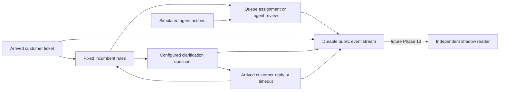

# Bounded clarification and primary helpdesk (Phases 11–12)

Phase 11 implements a predefined question selector, a one-question policy, and
offline usefulness evaluation. Phase 12 implements the independent primary system
that a later shadow worker can observe: intake, incumbent routing, customer replies,
agent actions, virtual time, durable ticket state, and an append-only event stream.

## Phase 11: question proposals

`ClarificationSelector` uses observable queue ambiguity. The v1 catalog supports
the existing workflow's `charge_or_refund` question for the billing/refund pair.
It proposes a question only when the top two queue probabilities have at least
0.65 combined mass, the leading probability is below 0.85, their gap is at most
0.20, and exactly two queues occupy those leading positions. Diffuse distributions,
three-way ties, unsupported pairs/languages, missing probabilities, and an exhausted
question budget fall back to review. No generated free-text questions are used.

The selector also accepts an incumbent's explicit pair of conflicting phrase-rule
matches. This path uses the pair directly and does not invent a probability score.
Each pair maps to one configured question. The simulator uses workflow version 2
with two additional predefined questions: `delivery_or_return` and
`account_or_checkout`. The original version 1 workflow, prepared data, and historical
routing policies remain separate and retain their original hashes.

`IntakePolicy` composes a route gate and the question selector. A route already
accepted by the supplied gate stays a route; otherwise an eligible question can
be proposed. The selector never enables a failed routing gate. Its history records
configured question IDs and enforces the workflow's one-question budget. Unknown
sufficiency stays null: queue uncertainty is not a learned judgment of whether
information is sufficient or a question will help.

```powershell
uv run --no-sync rightdesk clarification evaluate RUN_ID MODEL_ID artifacts/clarification/my-run
```

The command reads saved predictions and current individual human reviews from the
workbench. It writes a versioned proposal report, validated `PolicyDecision` records,
eligibility traces, a snapshot of the exact review revisions used, and checksums.
It never runs inference or sends a question. Existing output directories are
protected. `--catalog` defaults to `configs/clarification/retail_v1.yaml` and
`--database` defaults to the workbench catalog.

Usefulness metrics require actual reviewed `useful_question_ids`:

- Precision: useful selected questions / asked questions with known usefulness.
- Recall: selected useful questions / judgments listing at least one useful question.
- Ask rate when already sufficient: questions proposed on human judgments marked
  sufficient / all such joined judgments.

Metrics count individual latest reviewer judgments with explicit denominators;
unknowns are excluded independently per field. A zero denominator gives null,
not zero performance. Source eventual-owner labels are never substituted for human
usefulness. The 50-case review queue can supply these judgments later.

Completed development analysis across 863 tickets per model:

| Model | Question proposals | Coverage | Known human usefulness judgments |
|---|---:|---:|---:|
| TF-IDF | 0 | 0.00% | 0 |
| Laya | 7 | 0.81% | 0 |

These numbers describe the narrow selector's behavior, not successful clarification
or a Laya advantage. Human usefulness remains unmeasured. Current reports are
`artifacts/clarification/tfidf-development-v2/` and
`artifacts/clarification/laya-development-v2/`; v1 directories are earlier smoke runs.

## Phase 12: separate primary operations

The simulator has its own SQLite database at `artifacts/simulator/rightdesk.sqlite3`.
It does not modify the experiment catalog or source annotations. Frozen simulation
snapshots contain configuration, workflow, phrase rules, answer rules, and seed.
Changing a YAML file affects newly created sessions rather than existing ones.



The incumbent uses whole-word phrase rules over the arrived first message. A unique
queue match assigns the ticket. A supported two-queue conflict can ask one question;
unmatched or broader conflicts go to the agent inbox. A normal reply is interpreted
using that question's explicit answer phrases. One matching answer queue assigns;
unclear or conflicting answers go to an agent, with no second question. None of
these rules use Laya, saved predictions, source reference labels, future replies,
or human-review outcomes.

Primary actions use their own `IncumbentDecision` contract and execute only inside
the simulator. Offline `PolicyDecision` proposals retain `execution_mode=shadow`.
The incumbent is a separate mock operational baseline; it does not override or
reactivate the review-only Phase 7 candidate policies.

### Ticket lifecycle

| State | Supported next actions |
|---|---|
| New intake | Incumbent assigns, asks, or requests agent review immediately |
| `awaiting_customer` | Customer replies, or the response deadline expires |
| `awaiting_agent` | Agent assigns; late/additional clarification replies are recorded for review |
| `assigned` | Agent reassigns/resolves, or simulated service completes |
| `resolved` | Agent reopens into the review inbox |

Reopening preserves the message/question history and does not reset the question
budget. Unsupported languages go to review. A late response is preserved as a
public event and stays in manual review. Invalid state transitions and stale
ticket versions fail without publishing partial commands.

Time is a virtual UTC clock starting at the configured timestamp. The default
response timeout is 120 seconds and each assigned ticket has a 45-second service
delay. Advancing time processes due timers chronologically, with stable case-ID
ordering for ties. Assigned tickets resolve at their service deadline; unanswered
questions move to agent review. Timer processing and clock movement are one
transaction. A reply at an already processed deadline is late. This is a fixed
per-ticket service model with parallel queues, not a staffing, capacity, or SLA
simulation. There is no background clock or sleep loop.

### Commands and controls

```powershell
uv run --no-sync rightdesk simulate create --name "Manual helpdesk"
uv run --no-sync rightdesk simulate list
uv run --no-sync rightdesk simulate intake SIM_ID ticket.json --command-id intake-case-1
uv run --no-sync rightdesk simulate tickets SIM_ID
uv run --no-sync rightdesk simulate reply SIM_ID CASE_ID "This is a new charge" VERSION --command-id reply-1
uv run --no-sync rightdesk simulate agent SIM_ID CASE_ID assign VERSION --queue account --agent-id operator --command-id assign-1
uv run --no-sync rightdesk simulate advance SIM_ID 120 --command-id clock-1
uv run --no-sync rightdesk simulate events SIM_ID --after 0 --limit 500
uv run --no-sync rightdesk simulate verify SIM_ID
uv run --no-sync rightdesk simulate export SIM_ID artifacts/simulator/my-export
```

`ticket.json` uses the existing `TicketInput` contract. `VERSION` is the ticket's
current integer version, returned by intake/tickets commands. Agent actions are
`assign`, `reassign`, `resolve`, and `reopen`; only assignment actions take a queue.
`--expected-clock` optionally protects a clock command from concurrent changes.
Every command supports a simulator `--database` override. Create/demo/replay also
support `--config`.

Command IDs make retries idempotent: the same ID and request return the original
result without additional events. Reusing an ID for different data is rejected.
When omitted, the CLI generates an ID; supply one explicitly for retryable ingestion.
An idempotent retry returns the original command result, which can be older than
the current ticket state. Query `tickets` for the latest projection.

The dashboard's **Primary helpdesk** tab has the same controls: create a session,
submit a ticket, answer a question, act as an agent, advance time, inspect tickets,
and download public events. It validates expected versions and clock tokens.
`Refresh simulator state` explicitly reloads tokens after another session changes
the state. `RIGHTDESK_SIM_DATABASE` overrides the UI database path. No model SDK is
loaded by these operations.

### Event stream and recovery

Each public event has a global increasing `event_id`, simulation/case identity,
case version, virtual time, actor, kind, command ID, and payload. Events include
ticket creation, incumbent decisions, questions, arrived replies, timeouts,
assignments, reassignments, resolution, reopening, and agent-review requests.

SQLite transactions atomically commit the command result, events, and ticket
projection. Triggers prevent events/command records from being updated or deleted.
The event reader accepts a simulation ID, an exclusive `after` cursor, and a limit;
the CLI returns `next_cursor`. Cursor values are global, while reads filter to the
chosen simulation. Reading has no side effects and exposes no preplanned responses
or private scenario expectations. Phase 13 can consume this stream in a separate
process and reconstruct only the messages that have arrived.

`verify` replays the complete event stream from a consistent SQLite snapshot,
checks ordering/time/versions, and compares every reconstructed ticket with its
stored projection. Exports also take a consistent snapshot. They include public
events, ticket projections, a report, frozen configuration/code fingerprints, and
artifact hashes. Existing export directories are protected.

## Completed scenarios and actual-intake replay

```powershell
uv run --no-sync rightdesk simulate demo --output artifacts/simulator/new-demo
uv run --no-sync rightdesk simulate replay DATASET_ID --limit 50 --output artifacts/simulator/new-replay
```

The built-in YAML driver defines synthetic incoming messages, timed replies,
explicit scripted agent actions, and expected final states. The driver retains
future responses/expectations and submits text only at the scheduled time. Expected
states are checked after the run; they are not provided to the incumbent. If a
scenario fails, its committed partial session remains inspectable and no completed
export is published.

The 14-scenario run covers all six queues, all three bounded questions, no response,
an unhelpful answer, a conflicting answer, a late reply, unsupported language,
broader ambiguity, manual assignment/reassignment/resolution, and reopening.
It produces **81 events, 8 questions, 10 resolved tickets, and 4 agent-review tickets**.
All 14 lifecycle assertions pass and no ticket exceeds one question. This validates
software behavior rather than real question usefulness or routing accuracy.

The actual-intake replay queries only `cases.ticket_json` for development cases in
the workbench, checking that queue definitions align with the simulator. Seeded
hash ordering controls arrivals. It never reads reference labels, reviewer labels,
saved predictions, later ABCD dialogue, or final-test data. No customer response
is invented for these real research intake messages.

The completed **50-ticket development replay produces 172 events**: 22 tickets
finish simulated queue service and 28 enter agent review. No bounded question is
triggered in this selected sample. This is a lifecycle demonstration, not an
accuracy measurement. Current exports are `artifacts/simulator/demo-v2/` and
`artifacts/simulator/development-v2/`; earlier v1 smoke sessions remain in history.

## Verification

The full suite now has **175 passing tests**. Simulator tests cover ambiguity and question budgets,
unknown usefulness, gate preservation, source identity, explicit replies, timeouts,
late replies, duplicate deliveries, concurrent commands, stale versions/clocks,
append-only events, projection corruption, deterministic synthetic outcomes,
input-only development replay, and dashboard intake/reply/service/reopen flows.
Existing routing, calibration, catalog, and review tests continue to pass.

Phases 13-14 are complete: the [independent observer](shadow.md),
[comparison and final evaluation](results.md), and [handoff](handoff.md) are available.
Human usefulness still requires genuine reviewer judgments; no annotations are fabricated.
