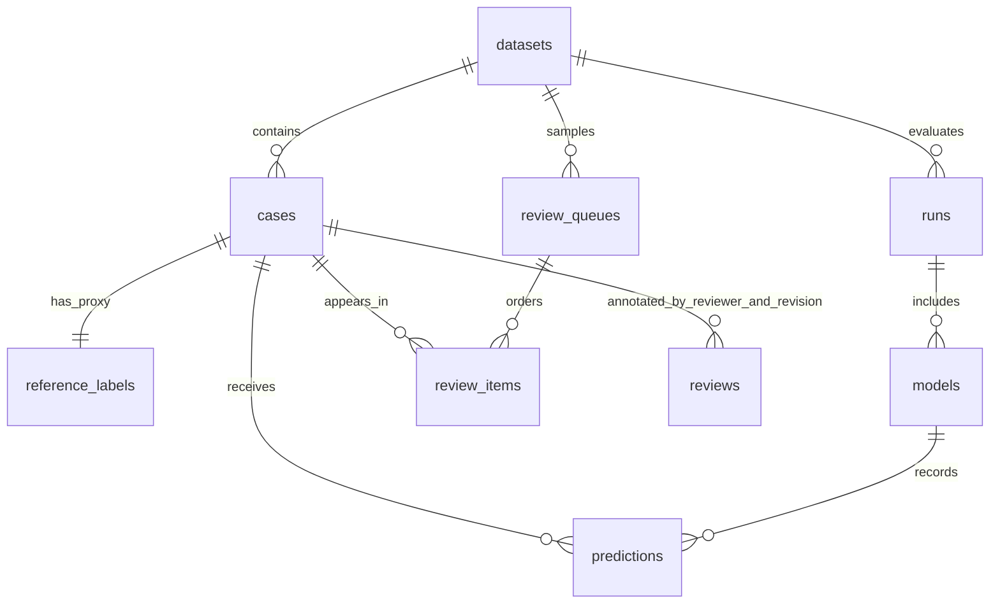

# Experiment workbench (Phases 8–10)

The workbench stores completed experiments in SQLite, exports portable Parquet
snapshots, displays model and policy results, and collects human intake judgments.
The dashboard and CLI call the same services. Browsing and review never load model
weights, refit a model, recalibrate probabilities, or execute ticket routing.

## Setup and launch

Run from the RightDesk project directory after preparing the dataset and completing
the development and calibration experiments described in the README:

```powershell
uv sync --locked --extra baseline --extra ml --extra data --extra ui
uv run --no-sync rightdesk store bootstrap
uv run --no-sync streamlit run apps/dashboard.py
```

The dashboard is available at `http://127.0.0.1:8501`. The tracked Streamlit config
binds to loopback and disables usage telemetry. A separate local environment can
install only the `ui` and `data` extras to browse existing catalog data; inference
dependencies are not imported by the workbench. `RIGHTDESK_DATABASE` overrides the
dashboard database path. Its default is resolved relative to the project, even
when the app launches from another working directory.

Bootstrap initializes `artifacts/workbench/rightdesk.sqlite3`, imports development
and calibration intake/reference records, registers the three known completed run
directories if present, and creates a 50-case random development review queue.
It reuses existing dataset/run/queue records by fingerprint. It does not download,
prepare data, run inference, or manufacture reviewer annotations. It can be run
again after another supported experiment finishes.

## Phase 8: catalog and exports

`storage.py` owns schema version 1, SQLite transactions, foreign keys, WAL mode,
and append-only annotation triggers. It rejects unrelated or unsupported databases.
Dataset and run imports validate all inputs before a single transactional insertion.
An interrupted or invalid import does not publish a partial dataset or run.



Dataset IDs are full manifest SHA256 values. Each case belongs to a dataset version,
so identical case IDs under different mappings or preparations cannot mix. Only
development and calibration files are loaded. Source reference labels remain
separate from ticket inputs and human reviews. The train and final-test files are
not read by these imports. Development/calibration normalized-group and conversation
isolation are checked again.

Run IDs derive from source `run.json` hashes. Registration accepts completed
development benchmarks and Phase 7 calibration-validation runs. It checks every
listed artifact checksum and rejects paths escaping the source directory. It also
requires the prediction/policy/decision files used by the import to appear in the
artifact manifest, validates schemas and exact evaluation membership, recomputes
queue accuracy, and verifies frozen policy decisions and enabled coverage. Failed
runs, prediction-only capture caches, and final-test runs are not admitted here.

Original configuration, metrics, policy workflow snapshots, and source manifests
are stored with predictions and decisions. Browsing remains possible if the source
artifact folder is moved or deleted. `verify-run` reports source availability or
checks its recorded hashes; historical code hashes describe that historical run,
not a requirement that today's source files remain byte-identical.

```powershell
uv run --no-sync rightdesk store init
uv run --no-sync rightdesk store import-dataset
uv run --no-sync rightdesk store register-run artifacts/laya-development-v1
uv run --no-sync rightdesk store register-run artifacts/calibration-v1
uv run --no-sync rightdesk store list-runs
uv run --no-sync rightdesk store verify-run RUN_ID
uv run --no-sync rightdesk store export-run RUN_ID artifacts/workbench/exports/my-run
```

Every store/review command accepts `--database PATH`. `import-dataset` additionally
accepts `--manifest` and `--workflow`. Bootstrap accepts `--root` for a different
project folder. Output directories and review export files cannot be overwritten.

`export-run` takes a consistent SQLite read snapshot and creates:

| File | Contents |
|---|---|
| `predictions.parquet` | Model identity, probabilities as nullable Arrow maps, recorded latency, optional policy decision |
| `tickets.parquet` | Exact intake text, channel/language, case identity, partition and duplicate group |
| `reference_labels.parquet` | Separate original proxy labels as contract JSON |
| `review_history.jsonl` | Separate append-only human annotation history for included cases |
| `run.json`, `dataset.json`, `workflow.json` | Original provenance/configuration snapshots |
| `models.json` | Per-model metrics and policy snapshots |
| `export.json` | Counts, source fingerprint, timestamp, and output hashes |

Null probabilities for rules and null timing for cached calibration analysis stay
null. A raw `predicted_queue` may be null when the original contract uses probability
argmax; apply `ModelPrediction.selected_queue()` for that interpretation. Inputs and
labels are not silently merged into a training table. Export uses staging and an
atomic directory rename, and can be read without the source folders or model SDK.

## Phase 9: dashboard

The **Experiments** tab compares accuracy, macro F1, Brier, ECE, and coverage. For
Phase 7 it presents candidate coverage and error in a separate table from enabled
shadow-policy coverage. A disabled policy is shown with zero enabled coverage.
Benchmark prediction coverage is explicitly labeled and is not a policy claim.
The view includes descriptive risk/coverage curves, reliability charts, per-queue
metrics, confusion matrices, historical provenance, and reviewed-subset statistics.

The **Ticket explorer** filters by model, prediction outcome, queue, policy action,
confidence, and literal text/case-ID search. It shows exact first-message text,
validated prediction records, and optional shadow decisions. Its CSV download
contains all matching cases, while the table displays at most 200. No model calls
run when a filter, tab, or selected experiment changes.

The **Human review** tab is a separate intake judgment flow. It supports queue
creation, pending/completed cases, reviewer progress, revision/reload handling,
post-save comparison, agreement, and annotation downloads. If the database or
catalog is absent, the app shows setup instructions instead of a traceback.

## Phase 10: human review

A queue has a stable configuration and ordered case IDs. Sampling can be random,
model disagreement, proxy-label errors, or lowest confidence. Sampling uses only
registered predictions, never fresh inference. Each queue keeps one representative
per normalized text group, with deterministic seed-based ordering. The default
partition is development; calibration is an explicit alternative. Final-test
cases are not available. Error, disagreement and low-confidence queues are purposive
subsets and must not be used as unbiased population accuracy estimates.

Use your own stable reviewer ID. It is an asserted local identity, not an authenticated
account. The review form initially displays the first customer message and queue/
question definitions. It hides model outputs, source eventual-owner labels, and
other reviewers' labels. A reviewer may reveal the selected experiment's comparison
after saving their own judgment. Other workbench tabs expose model results for
analysis, so this is a workflow for reducing anchoring, not an access-control barrier.

Each submission provides at least one intake judgment:

- Acceptable queues: null means unknown, an empty list means none acceptable yet,
  and a nonempty list identifies acceptable configured queues.
- Sufficiency: null means unknown, false means more information is needed, and true
  means enough information is available to route.
- Useful predefined questions: null means unknown; an empty list means no configured
  question is useful; a list records useful configured question IDs.

Notes are optional. Notes alone do not mark a case reviewed. The original eventual-
owner proxy is retained unchanged and is not editable in an intake review. Judgments
are validated using `ReviewedLabel` and the dataset's exact workflow version.

Reviews are append-only per dataset/case/reviewer with increasing revisions. An
expected-revision token prevents stale or concurrent forms from overwriting another
save. SQLite triggers reject history updates and deletions. Reloading explicitly
fetches a newer revision. Pending counts are reviewer-specific, allowing two people
to label the same queue independently. No automated consensus is created.

```powershell
uv run --no-sync rightdesk review list-queues
uv run --no-sync rightdesk review create-queue DATASET_ID --title "Disagreements" --strategy disagreement --run-id RUN_ID --model-id tfidf_logistic --comparison-model laya
uv run --no-sync rightdesk review submit human-submission.json
uv run --no-sync rightdesk review agreement DATASET_ID
uv run --no-sync rightdesk review evaluate RUN_ID MODEL_ID
uv run --no-sync rightdesk review export DATASET_ID artifacts/workbench/latest-annotations.jsonl
uv run --no-sync rightdesk review export DATASET_ID artifacts/workbench/annotation-history.jsonl --history
```

`review submit` consumes a human-authored `ReviewSubmission` JSON object: dataset_id,
case_id, reviewer_id, expected_revision (zero for the first save), optional intake
judgments above, and notes. The CLI and dashboard use identical validation and
revision checks. Export records wrap the validated `label` alongside annotation ID,
dataset/case/reviewer identity, revision, notes, and timestamp. Latest export keeps
one record per reviewer/case; history includes all revisions.

Agreement uses latest individual reviews on shared cases. It reports exact acceptable-
queue set agreement, mean Jaccard overlap, and sufficiency agreement/Cohen's kappa.
Unknowns are excluded separately for each metric. Empty queue sets are explicit
judgments, and two empty sets agree. Kappa is null for insufficient pairs or a
degenerate constant-label denominator. Reviewed evaluation reports model acceptability
against individual judgments with explicit counts; it does not invent a consensus
target or treat an unknown field as false. Human labels never feed back into training
or policy calibration automatically.

## Completed local verification

The catalog contains 3 runs, 14 model entries, 7,833 predictions, and 1,926 intake
cases. A checksummed calibration export contains 1,792 predictions and 256 tickets.
The 50-case default review queue is ready; actual human annotations remain pending.
The saved Phase 7 policies retain their review-only gates.

All **175 automated tests pass**, including simulator, observer and final-result checks,
with lint, formatting, and the locked dependency
check passing. The suite covers import idempotence, corruption/rollback, dataset and
case identity, source loss with cached browsing, Parquet round trips, unknown versus
negative judgments, invalid labels, revision history, concurrent saves, sampling,
reviewer-specific progress, agreement and reviewed metrics. Streamlit AppTest covers
empty state, failed-gate display, filters, blind review, explicit saves, next-case
navigation, post-save reveal, and stale forms. Browser inspection verifies the local
dashboard renders the real experiment metrics. Real reviewers must supply the human
judgments; test annotations are confined to temporary synthetic stores.
